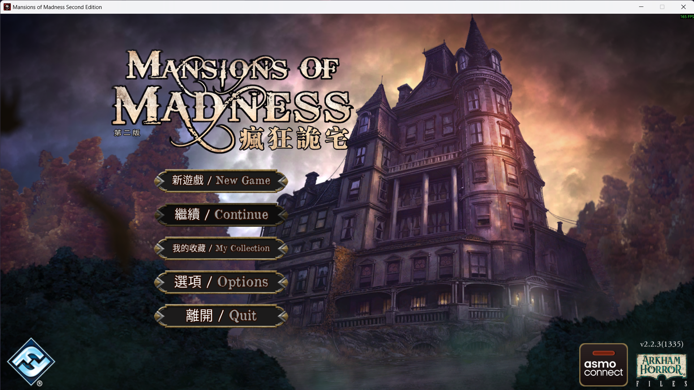
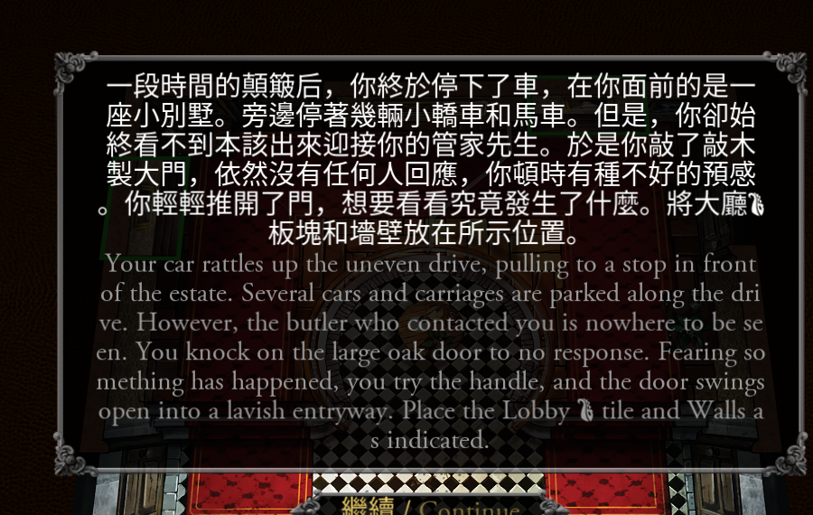

# 疯狂诡宅 中英双语 Mod（Mansions of Madness Bilingual）

在游戏内置中文文本的下方（短文本则在同行后方）追加对应的英文原文。

- Mod 版本：1.1.0
- 游戏版本：Mansions of Madness v2.2.3（Unity 2022.3.62f3，32 位 Mono）
- 加载器：BepInEx 5.4.23.3 **x86**
- 平台：Windows

Mod 以 BepInEx + Harmony 运行时补丁的形式工作，不修改任何 AssetBundle、游戏程序集或存档文件，也不附带游戏资源。





## 目录

- [特性](#特性)
- [环境要求](#环境要求)
- [安装](#安装)
- [配置](#配置)
- [从源码构建](#从源码构建)
- [工作原理](#工作原理)
- [已知限制](#已知限制)
- [卸载](#卸载)
- [排查](#排查)
- [兼容性](#兼容性)

## 特性

- **界面覆盖**：主菜单、选项、剧本选择、调查员选择、初始物品、物品与调查员名称。
- **剧情与提示**：剧本标题与简介、载入引文、序章/剧情段落、消息弹窗、按钮与提示文字。
- **动态插入文本**：正确处理带 `{0}` 等占位符的本地化条目，用英文模板与映射后的英文参数重新格式化。
- **自动排版**：
  - 英文默认使用较暗的颜色显示在中文下方；
  - 短文本（中文字符数不超过阈值且不含换行）显示为 `中文 / English`；
  - 长段落自动收窄宽度、留出左右边距，并取消行数上限；
  - 剧情段落在中英文排版完成后重新堆叠，避免文本重叠；
  - 固定尺寸标签自动改为缩小适配，避免第二行被裁切。
- **场景设置提示**：剧情/板块提示以及其中的插入值也会映射为英文。
- **可配置**：总开关、仅中文语言生效、英文颜色、同行阈值、段落宽度、调试导出。

## 环境要求

| 项目 | 要求 |
|---|---|
| 游戏 | Mansions of Madness v2.2.3（32 位） |
| Mod 加载器 | BepInEx 5.4.23.3 **x86** |
| 游戏语言 | 中文（`General.OnlyChinese` 开启时） |
| 构建（可选） | 支持 `netstandard2.1` 的 .NET SDK，如 .NET 6 或更高 |

> 必须使用 **32 位（x86）** 的 BepInEx，64 位版本无法注入这款游戏。

## 安装

1. 将 **32 位** BepInEx 5.4.23.3 安装到游戏根目录，即 `Mansions of Madness.exe` 所在目录。
2. 将 `MansionsBilingual.dll` 放入 `BepInEx/plugins/MansionsBilingual/`。
3. 启动游戏，并在游戏内将语言设为中文。

安装完成后的目录结构：

```text
Mansions of Madness/
├─ winhttp.dll
├─ doorstop_config.ini
├─ BepInEx/
│  ├─ core/...
│  ├─ plugins/MansionsBilingual/MansionsBilingual.dll
│  └─ config/local.mansions.madness.bilingual.cfg   # 首次启动后生成
└─ Mansions of Madness.exe
```

首次启动会生成配置文件；修改配置后需要重启游戏才能生效。

## 配置

配置文件：`BepInEx/config/local.mansions.madness.bilingual.cfg`

| 键 | 默认值 | 说明 |
|---|---|---|
| `General.Enabled` | `true` | 总开关 |
| `General.OnlyChinese` | `true` | 仅在游戏语言为中文时追加英文 |
| `Appearance.EnglishColor` | `9A9A9A` | 英文使用的 NGUI 颜色（RRGGBB）；留空表示与中文同色 |
| `Appearance.InlineSeparator` | ` / ` | 短文本同行显示时使用的分隔符 |
| `Appearance.InlineMaxLength` | `8` | 中文字符数不超过该值且不含换行时，英文显示在同一行 |
| `Appearance.ParagraphWidthPercent` | `88` | 自动换行段落标签的宽度百分比，用于给较长的英文留出左右边距 |
| `Debug.DumpLocalization` | `false` | 将合并后的本地化表导出为 `BepInEx/MoMBilingual_dump_<资源名>.tsv`，用于排查 |

说明：

- `Appearance.EnglishColor` 只写 RRGGBB，不加 `#`。
- BepInEx 写配置时会去掉首尾空白，`InlineSeparator` 可能被保存为 `/`；运行时会自动还原为带空格的 ` / `。

## 从源码构建

仓库结构：

```text
.
├─ src/MoMBilingual/
│  ├─ Plugin.cs
│  └─ MoMBilingual.csproj
├─ build.ps1
├─ preview.png
├─ scene_setup.png
├─ README.md
└─ .gitignore
```

构建：

```powershell
dotnet build src/MoMBilingual/MoMBilingual.csproj -c Release
```

输出为 `src/MoMBilingual/bin/Release/netstandard2.1/MansionsBilingual.dll`，将其复制到 `BepInEx/plugins/MansionsBilingual/`。

也可以在 Windows PowerShell 中运行 `build.ps1`，脚本会构建并复制 DLL 到 `..\BepInEx\plugins\MansionsBilingual\`，因此要求本仓库位于游戏根目录下（与 `BepInEx` 同级）。

### 程序集引用

`MoMBilingual.csproj` 以 `HintPath` 相对路径引用以下程序集，均设置 `Private=false`（不复制到输出）：

- `BepInEx/core/BepInEx.dll`
- `BepInEx/core/0Harmony.dll`
- `Mansions of Madness_Data/Managed/Assembly-CSharp.dll`
- `Mansions of Madness_Data/Managed/UnityEngine.dll`
- `Mansions of Madness_Data/Managed/UnityEngine.CoreModule.dll`
- `Mansions of Madness_Data/Managed/UnityEngine.AssetBundleModule.dll`

默认 `HintPath` 以 `../../../` 开头，即期望本仓库放在游戏根目录下的一个子目录中。如果仓库位置不同，请把各 `<HintPath>` 改为指向实际的游戏安装目录与 BepInEx 目录。目标框架为 `netstandard2.1`。

## 工作原理

入口为 `src/MoMBilingual/Plugin.cs`，通过 Harmony 在运行时给游戏方法打补丁：

| 补丁目标 | 类型 | 作用 |
|---|---|---|
| `Localization.Get(string, bool, ulong)` | Postfix | 按 `English` 语言列在中文结果后追加英文 |
| `Localization.LoadCSV` | Postfix | 按需导出本地化表，并触发英文预载 |
| `UILabel.text`（setter） | Postfix | 多行标签增加行距、固定标签缩小适配、段落收窄与取消行数上限 |
| `MoM_CutsceneItem.Start` | Postfix | 剧本文本排版后重新堆叠段落，避免重叠 |
| `MoM_MessagePopup.InitializePopup` | Postfix | 长弹窗文本改为缩小适配，避免盖住按钮 |
| `MoM_LocalizationPacket.CalculateArguments` | Prefix / Finalizer | 参数计数期间暂停装饰 |
| `MoM_LocalizationPacket.ResolveInsert` | Prefix / Finalizer | 插入值解析期间暂停装饰 |
| `MoM_LocalizationPacket.ResolveLocalization()` | Prefix / Finalizer | 解析期间暂停装饰 |
| `MoM_LocalizationPacket.ResolveLocalization(GameObject&)` | Prefix / Finalizer | 解析期间暂停装饰 |
| `PersistantGameObject.CoroutineLoadScenarioLocalization` | Prefix | 进入剧本时补载 `en` 表并合并缓存的英文 |
| `LocalizedTextNGUI.UpdateLocalization(MoM_LocalizationPacket)` | Postfix | 中文格式化完成后追加英文 |

数据流简述：

1. **英文表预载**：启动后等待 `MoM_AssetLoader` 初始化，遍历本地化 AssetBundle（跳过主表），解析 `*_en.bytes` 文本资源，按剧本缓存英文表。
2. **普通条目**：`Localization.Get` 返回后，若存在英文列、英文与中文不同、英文不含中文，则按短文本/段落规则追加英文。
3. **占位符条目**：解析阶段只处理纯中文；从中文格式化结果中按字面片段切分出参数，逐项映射为英文，再用英文模板 `string.Format`，最后由 `LocalizedTextNGUI` 追加英文。中文模板中不存在的多余占位符会被移除，无法可靠解析的组合则保持中文。
4. **排版修正**：追加英文后的标签会被记录，`UILabel.text` 补丁据此调整行距、溢出方式、行数上限与段落宽度。

## 已知限制

- NGUI 在行尾遇到放不下的英文单词时会从中间断开（如 `inve / stigation`），这是游戏原生文本排版器的行为，英文越长越明显。
- 底部圆形小按钮（返回剧本选择、选择调查员、继续设置等）空间很窄，英文可能换成 2–4 行并略微超出按钮图形。
- 场景设置消息依赖按中文插入值切分参数；极少数无法可靠切分的组合消息仍保持中文。
- 英文列中混入中文的条目会被跳过，以避免重复显示中文。
- 未修改 AssetBundle 与游戏程序集，游戏小版本更新通常仍然兼容；若大版本更新改变 UI 结构，个别标签的排版可能需要调整。

## 卸载

- 仅关闭 Mod：删除 `BepInEx/plugins/MansionsBilingual/`。
- 完全移除 BepInEx：再删除游戏根目录下的 `winhttp.dll`、`doorstop_config.ini` 与 `BepInEx/` 文件夹。

## 排查

- **没有出现英文**：确认游戏语言为中文、`General.Enabled=true`、使用的是 x86 版 BepInEx，并检查 `BepInEx/LogOutput.log` 是否包含 `Bilingual localization patch applied.`。
- **部分文本没有英文**：该条目可能缺少英文列、英文与中文相同、英文含中文，或含占位符，因而按设计跳过。
- **排版异常**：调整 `Appearance.ParagraphWidthPercent`、`Appearance.InlineMaxLength`、`Appearance.EnglishColor` 后重启游戏。
- **需要分析本地化数据**：临时开启 `Debug.DumpLocalization`，查看导出的 `MoMBilingual_dump_*.tsv`。
- **补丁加载失败**：日志中出现 `Failed to patch localization` 时，通常是 BepInEx 位数不匹配或游戏版本与引用的程序集不一致。

## 兼容性

| 游戏版本 | 状态 |
|---|---|
| v2.2.3 | 已验证 |
